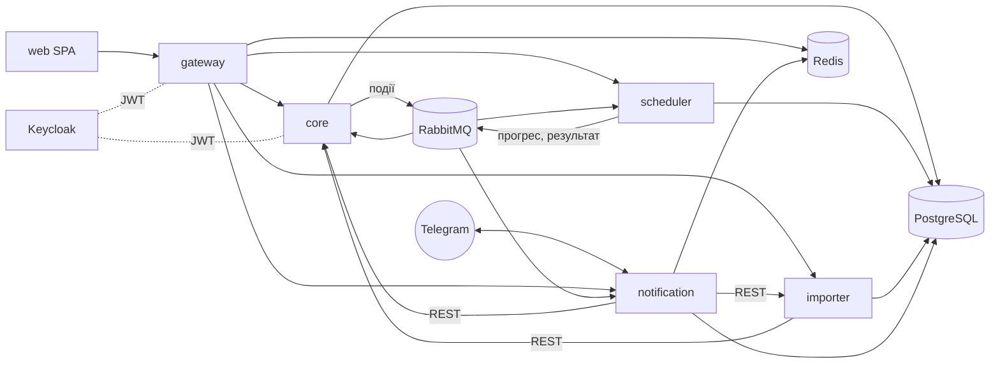

# Розклад ВТФК

Вебзастосунок і Telegram-бот для розкладу, замін і розпоряджень Вінницького технічного фахового коледжу.
Курсовий проєкт з дисципліни «Технології проєктування мережевих ресурсів».
Автор: Закушняк Дмитро, група 4КІ1. Керівник: Кренцін М. Д.

Студент бачить розклад своєї групи разом із сьогоднішніми замінами. Викладач отримує в Telegram повідомлення, що його поставили на заміну, і відповідає однією кнопкою. Диспетчер навчальної частини підбирає заміни з підказками, друкує розпорядження у формі коледжу й одним натиском розсилає його в чати груп.

## Що вміє

**Публічний сайт** (PWA, працює й офлайн)
- Пошук групи, викладача чи аудиторії. Пошук розуміє латиницю (`4ki1` → 4КІ1), помилки й англійську розкладку (`rhtywsy` → Кренцін).
- Розклад на день і на тиждень, чисельник і знаменник, підгрупи. Заміни підсвічено.
- Окремі сторінки змін, дзвінків і «що зараз за пара». Є експорт в iCal і QR-табличка на двері аудиторії.

**Кабінет викладача**
- Нові заміни з кнопками «Добре» / «Не можу». Відповідь одразу бачить диспетчер.
- Повідомлення про відсутність на день або на окремі пари.
- Побажання для генератора розкладу: які пари незручні, а коли викладач недоступний.

**Навчальна частина**
- Робоче місце замін. Зліва відсутні, посередині їхні пари, справа варіанти. Рекомендація пояснює, чому варіант кращий, і вміє скласти план на весь день.
- Розпорядження у форматі паперового: номер присвоюється під час публікації, є доповнення, вивантаження у DOCX, PDF і PNG.
- Редактор розкладу з перетягуванням, перевіркою конфліктів на сервері та порівнянням версій.
- Генерація розкладу (Timefold): прогрес наживо, «Було / Стало», аналіз порушених обмежень.
- Облік годин: план, факт, прогноз і дата, коли предмет буде вичитано.
- Імпорт з Excel, DOCX, PDF і фото. Фото розпорядження чи скан навчального плану розпізнає Claude, а людина перевіряє результат.
- Календар (семестри, канікули, практика), довідники, налаштування, прив'язка чатів до бота.

**Telegram-бот**
- Розклад на сьогодні й завтра, пошук, дзвінки, «чисельник чи знаменник».
- Викладач повідомляє про відсутність кнопками або простим текстом («лікарняний до п'ятниці»).
- Групу прив'язують до бота одноразовим кодом від адміністратора. Після публікації розпорядження група отримує лише свої рядки й картинку. Ранковий розклад група вмикає сама командою `/rozklad_on`.

## Архітектура

Це монорепозиторій: Maven-реактор із бекендом і окремий npm-проєкт клієнта.

```
libs/contracts          спільні події (записи Java), версії подій
services/gateway  :8080 єдиний вхід API: маршрути, CORS, ліміти запитів (Redis)
services/core     :8081 предметна область: довідники, календар, розклад, заміни, розпорядження, облік
services/scheduler:8082 генерація розкладу (Timefold)
services/importer :8083 імпорт Excel/DOCX/PDF/фото, AI (Anthropic API)
services/notification :8084 Telegram-бот, доставка повідомлень, рендер розпоряджень
web/                    React 19 + TypeScript strict + Vite, PWA
infra/                  docker compose, Keycloak, Postgres, продакшн-розгортання (Caddy)
docs/                   архітектура, контракти, предметна область, модулі
```



- **Вхід.** Keycloak (OIDC, PKCE) з ролями ADMIN, TEACHER і SERVICE. Реєстрація відбувається за запрошенням, паролі зберігає Keycloak у вигляді хешів.
- **Події.** Core публікує події через outbox (Spring Modulith) в обмінник `rozklad.events`. Споживачі ідемпотентні. Браузер отримує оновлення через SSE.
- **Бази.** Кожен сервіс має власну базу в одному PostgreSQL 18, міграції виконує Flyway.

Детально: [docs/ARCHITECTURE.md](docs/ARCHITECTURE.md), [docs/CONTRACTS.md](docs/CONTRACTS.md), [docs/DOMAIN.md](docs/DOMAIN.md).

## Запуск локально

Потрібні Docker Desktop, Git Bash, JDK 25, Maven 3.9 і Python 3.10+.

```bash
cp .env.example .env        # впишіть TELEGRAM_BOT_TOKEN, TELEGRAM_OWNER_CHAT_ID, ANTHROPIC_API_KEY (за потреби)
scripts/dev-stack.sh up --web            # інфраструктура, збірка, 5 сервісів і сайт
scripts/dev-stack.sh seed                # реальні дані коледжу через API (~3 хв)
```

Без бота: `scripts/dev-stack.sh up --web --no-telegram`.

| Що | Адреса |
|---|---|
| Сайт | http://localhost:8088 |
| API (gateway) | http://127.0.0.1:8080 |
| Swagger core | http://localhost:8081/swagger-ui.html |
| Keycloak | http://localhost:8180 |
| RabbitMQ | http://localhost:15672 |

Демо-користувачі (`admin`, `krentsin`, `nepyivoda`) і їхні локальні паролі лежать у `infra/keycloak/demo-users.env`. Це паролі лише для локальної розробки, на сервері вони інші.

Клієнт окремо, з моками й без бекенду: `cd web && npm ci && npm run dev:mock` (http://localhost:5180).

Усе про запуск: [docs/RUNNING.md](docs/RUNNING.md). Розгортання на VPS: [docs/DEPLOY.md](docs/DEPLOY.md).

## Перевірки

```bash
source scripts/env.sh
mvn verify                                 # юніт- та інтеграційні тести (Testcontainers), ArchUnit, Modulith
cd web && npm run lint && npm test && npm run build
npm run e2e                                # Playwright на моках
```

CI (`.github/workflows/ci.yml`) запускає бекенд, клієнт і перевірку конфігурації розгортання.

## Секрети

Справжні значення зберігаються лише в `.env`, а він у `.gitignore`. У репозиторії є тільки `.env.example`, `infra/deploy/.env.example` і dev-значення для локального Keycloak.
